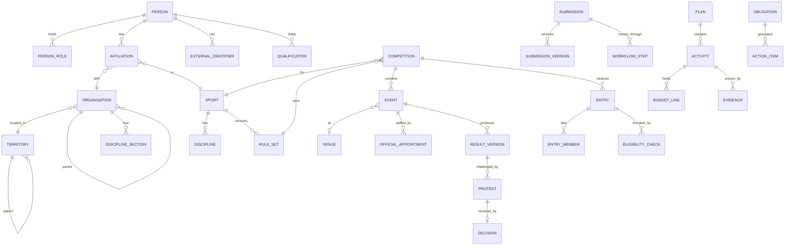

# 03 — Domain Model

Conventions for every table unless stated: `id uuid primary key default uuid_generate_v7()`, `created_at timestamptz`, `created_by uuid`, `updated_at timestamptz`, `updated_by uuid`, `version int not null default 1`. Enumerations are Postgres enums or lookup tables (prefer lookup tables for anything a federation may extend).

## 1. Core relationships

## 2. Reference & geography (`ref`, `territories`)

| Table | Key columns |
|---|---|
| `territories.territory` | `code`, `name_i18n jsonb`, `level` (`region`/`zone`/`woreda`/`city`/`sub_city`/`kebele`), `parent_id`, `geom geometry(MultiPolygon,4326)` nullable |
| `ref.sport` | `code` (`football`, `athletics`, `volleyball`, `cycling`…), `name_i18n`, `family` (`team_match`/`measured_timed`/`combat_judged`/`racket_mind`/`traditional_para`), `plugin_key`, `status` |
| `ref.discipline` | `sport_id`, `code` (e.g. `track`, `field`, `road_race`, `beach`), `name_i18n` |
| `ref.category` | `sport_id`, `code`, `name_i18n`, `gender` (`women`/`men`/`mixed`/`open`), `age_min`, `age_max`, `para_class` nullable, `rule_set_id` |
| `ref.rule_set` | `sport_id`, `owner_org_id`, `code`, `version`, `effective_from`, `effective_to`, `status` (`draft`/`approved`/`retired`), `config jsonb` (validated by plugin Zod schema), `approved_by`, `approved_at` |

## 3. Institutions (`institutions`)

| Table | Key columns |
|---|---|
| `organisation` | `type` (`bureau`, `territorial_office`, `federation`, `club`, `academy`, `school`, `university`, `facility_operator`, `national_body`, `partner`), `legal_name_i18n`, `short_name`, `parent_id`, `territory_id`, `sport_id` (for federations), `recognition_status` (`unverified`/`pending`/`recognised`/`suspended`/`dissolved`), `contacts jsonb`, `geo_point` |
| `recognition_record` | `org_id`, `recognised_by_org_id`, `instrument_ref`, `document_id`, `valid_from`, `valid_to`, `status` |
| `discipline_section` | `org_id`, `sport_id`, `discipline_id`, `status`, `head_person_id` |
| `committee` | `org_id`, `name_i18n`, `type` (`executive`, `technical`, `disciplinary`, `appeals`, …) |
| `office_term` | `committee_id`, `person_id`, `position`, `start_date`, `end_date`, `appointment_document_id` |
| `signatory` | `org_id`, `person_id`, `scope` (`finance`, `entries`, `general`), `valid_from`, `valid_to` |
| `org_affiliation` | `child_org_id`, `parent_org_id`, `sport_id`, `valid_from`, `valid_to`, `status` (club ↔ federation, federation ↔ national body) |

## 4. People — Athlete 360 (`people`)

| Table | Key columns |
|---|---|
| `person` | `given_name`, `father_name`, `grandfather_name` (Ethiopian naming), `names_i18n jsonb`, `sex` (as recorded on ID; nullable), `date_of_birth`, `dob_precision` (`day`/`month`/`year`), `phone`, `email`, `territory_id`, `photo_document_id`, `identity_status` (`unverified`/`pending`/`verified`/`disputed`), `is_minor` (generated), `merged_into_id` nullable, `classification` default `confidential` |
| `identity_evidence` | `person_id`, `type` (`kebele_id`, `fayda_national_id`, `passport`, `birth_certificate`, `school_record`, `other`), `number_hash`, `number_last4`, `document_id`, `verified_by`, `verified_at`, `status` — **store hash + last 4, not full ID numbers** unless OD-05 says otherwise |
| `person_role` | `person_id`, `role_type` (`athlete`, `coach`, `official`, `staff`, `guardian`, `administrator`), `sport_id` nullable, `start_date`, `end_date`, `status` |
| `affiliation` | `person_id`, `org_id`, `discipline_section_id`, `sport_id`, `discipline_id`, `role_type`, `category_id` nullable, `start_date`, `end_date`, `status` (`requested`/`active`/`ended`/`suspended`/`rejected`), `source_submission_id` — **exclusion constraint**: no overlapping *active* athlete affiliations for same person+sport unless rule set allows multiple (`allow_multi_club`) |
| `guardian_link` | `minor_person_id`, `guardian_person_id`, `relationship`, `evidence_document_id`, `status`, `consent_scopes text[]` |
| `external_identifier` | `person_id`, `issuer_org_id`, `scheme` (`EFF`, `FIFA_ID`, `WA_ID`, `UCI_ID`, …), `value`, `verified_at`, `verified_by`, `status` |
| `duplicate_candidate` | `person_a_id`, `person_b_id`, `score numeric`, `signals jsonb` (name trigram, dob, phone, evidence hash), `status` (`open`/`same_person`/`different_people`/`held`), `decided_by`, `decided_at`, `reason` |
| `correction_request` | `person_id`, `requested_by`, `field`, `current_value`, `requested_value`, `evidence_document_id`, `status`, `decision_reason` |
| `merge_log` | `survivor_id`, `merged_id`, `decided_by`, `reason`, `moved_refs jsonb` (for reversibility) |

Athlete 360 view = person + roles + affiliations (all sports, dated) + registrations + validated results (per sport) + qualifications + referrals + clearance **status** + external IDs + documents status.

## 5. Qualifications (`qualifications`)

| Table | Key columns |
|---|---|
| `qualification_type` | `sport_id`, `role_type` (`coach`/`referee`/`commissioner`/`starter`/`timekeeper`/`judge`/`scorer`/`commissaire`/…), `code`, `name_i18n`, `level`, `issuer_org_id`, `validity_months` nullable, `rule_set_id` |
| `qualification` | `person_id`, `qualification_type_id`, `certificate_no`, `issue_date`, `expiry_date`, `evidence_document_id`, `verification_status` (`claimed`/`pending_issuer`/`verified`/`rejected`/`expired`), `verified_by`, `verified_at` |
| `availability` | `person_id`, `from`, `to`, `status` |
| `conflict_declaration` | `person_id`, `org_id`, `nature`, `declared_at`, `valid_to` |
| `course`, `course_session`, `course_enrolment`, `assessment` | Education & CPD (module `education`, phase 3) |

## 6. Competitions core (`competitions`)

| Table | Key columns |
|---|---|
| `competition` | `sport_id`, `organiser_org_id`, `rule_set_id`, `name_i18n`, `level` (`club`/`zonal`/`regional`/`all_oromia_games`/`invitational`), `season_label`, `start_date`, `end_date`, `status` (`draft`/`approved`/`entries_open`/`entries_closed`/`scheduled`/`in_progress`/`completed`/`closed`/`cancelled`), `format jsonb` (plugin-validated), `multi_sport_games_id` nullable |
| `multi_sport_games` | e.g. All Oromia Games: shared logistics, accreditation, delegations, reporting |
| `competition_category` | `competition_id`, `category_id`, `entry_standard jsonb` |
| `stage` | `competition_id`, `type` (`league`, `group`, `knockout`, `round`, `heat`, `semi`, `final`, `stage_race_stage`), `order` |
| `event` | `competition_id`, `stage_id`, `category_id`, `sport_event_code` (e.g. `100m`, `long_jump`, `road_race`), `venue_id` / `route_version_id`, `scheduled_at`, `status` (`scheduled`/`ready`/`in_progress`/`completed`/`suspended`/`abandoned`/`postponed`), `payload jsonb` (plugin) |
| `participant_slot` | `event_id`, `entry_id` or `team_entry_id`, `slot` (home/away, lane, bib, start order, pool) |
| `entry` | `competition_id`, `category_id`, `submitting_org_id`, `type` (`team`/`individual`/`relay`), `team_name`, `status` (`draft`/`submitted`/`under_review`/`returned`/`accepted`/`rejected`/`withdrawn`), `submission_id` |
| `entry_member` | `entry_id`, `person_id`, `role` (`player`, `captain`, `coach`, `manager`, `rider`, …), `shirt_or_bib`, `status` |
| `eligibility_check` | `entry_member_id`, `rule_set_id`, `rule_code`, `outcome` (`pass`/`fail`/`exception`), `details jsonb`, `overridden_by`, `override_reason` (human decision) |
| `official_appointment` | `event_id`, `person_id`, `role`, `status` (`proposed`/`confirmed`/`declined`/`withdrawn`), `qualification_check jsonb`, `conflict_check jsonb` |
| `result_version` | `event_id`, `seq int`, `previous_id`, `status` (`draft`/`submitted`/`validated`/`published`/`under_protest`/`superseded`/`void`), `payload jsonb` (plugin schema), `submitted_by`, `validated_by`, `published_at`, `reason`, `decision_id` nullable, `source` (`manual`/`import`/`device_feed`/`offline_sync`), `hash` — **append-only; UPDATE only allowed on status via trigger** |
| `match_event_log` | `event_id`, `result_version_id`, `minute/time`, `type`, `person_id`, `payload` (football goals/cards/subs; volleyball sets; cycling incidents) |
| `standing_snapshot` | `competition_id`, `stage_id`, `computed_at`, `rule_set_id`, `table jsonb`, `based_on_result_ids uuid[]` |
| `record` | `sport_id`, `discipline_id`, `category_id`, `scope` (`regional`, `games`, `championship`), `mark`, `person_id`, `result_version_id`, `ratified_by`, `status` |

## 7. Accreditation (`accreditation`)

`zone` (per venue/games), `credential_type` (role → zones), `credential` (`person_id`, `games_or_competition_id`, `type_id`, `zones`, `token_kid`, `status` `issued/suspended/revoked/expired`, `valid_from`, `valid_to`), `scan_log` (`credential_id`, `zone_id`, `device_id`, `scanned_at`, `outcome`, `offline bool`), `delegation` (org → competition, head of delegation).

## 8. Disputes (`disputes`)

| Table | Key columns |
|---|---|
| `protest` | `target_type` (`result_version`/`eligibility`/`appointment`), `target_id`, `lodged_by_org_id`, `lodged_at`, `deadline_at`, `grounds`, `fee_reference`, `status` (`lodged`/`admissible`/`inadmissible`/`under_review`/`upheld`/`dismissed`/`withdrawn`/`appealed`) |
| `decision` | `case_type`, `case_id`, `body_committee_id`, `decided_at`, `outcome`, `reasoning`, `document_id`, `signed_by uuid[]` |
| `appeal` | `decision_id`, `lodged_at`, `status`, `appeal_decision_id` |
| `sanction` | `person_id`/`org_id`, `sport_id`, `type`, `from`, `to`, `matches int`, `decision_id` — **always created from a human decision** |

## 9. Workflow, documents, obligations (`workflow`, `documents`, `obligations`)

| Table | Key columns |
|---|---|
| `documents.document` | `owner_org_id`, `title`, `type`, `classification` (`public`/`internal`/`confidential`/`restricted`), `current_version_id`, `retention_class` |
| `documents.document_version` | `document_id`, `seq`, `object_key`, `sha256`, `mime`, `size`, `uploaded_by`, `note` |
| `workflow.definition` | `code` (`plan_approval`, `club_recognition`, `person_registration`, `team_entry`, `result_validation`, `booking`, …), `version`, `steps jsonb` (see 05-workflows.md) |
| `workflow.submission` | `definition_id`, `subject_type`, `subject_id`, `org_id`, `sport_id`, `territory_id`, `state`, `current_step`, `due_at`, `submitted_by` |
| `workflow.submission_version` | `submission_id`, `seq`, `payload jsonb`, `attachments uuid[]` |
| `workflow.step_log` | `submission_id`, `step`, `action` (`submit`/`approve`/`return`/`reject`/`escalate`/`delegate`/`withdraw`/`comment`), `actor_id`, `actor_role`, `reason`, `at` |
| `obligations.obligation` | `org_type`/`org_id`, `sport_id`, `code`, `title_i18n`, `recurrence` (RRULE), `due_rule`, `evidence_required jsonb`, `owner_role` |
| `obligations.obligation_instance` | `obligation_id`, `org_id`, `period`, `due_at`, `status` (`not_due`/`open`/`submitted`/`accepted`/`overdue`/`waived`), `submission_id` |
| `obligations.action_item` | `source_type`, `source_id`, `title`, `assignee_person_id`, `owner_org_id`, `due_at`, `priority`, `status` (`open`/`in_progress`/`awaiting_evidence`/`closed`/`cancelled`), `closure_evidence_ids uuid[]` — **cannot close without evidence unless type allows** |

## 10. Plans & grants (`plans_grants`)

`plan` (`org_id`, `fiscal_year`, `status`, `submission_id`), `activity` (`plan_id`, `pillar`, `title`, `owner_person_id`, `territory_id`, `sport_id`, `start/end`, `targets jsonb`, `status`), `milestone`, `budget_line` (`activity_id`, `category`, `amount numeric(18,2)`, `currency`, `funding_source`), `funding_decision` (`plan_id`/`activity_id`, `approved_amount`, `finance_reference`, `decided_by`), `delivery_report` (`activity_id`, `period`, `narrative`, `indicators jsonb`, `verification_status`), `evidence` (`document_id`, `subject`), `acquittal` (`funding_decision_id`, `spent_amount`, `finance_reference`, `reconciled_by`, `status`).

## 11. Development & talent (`development`, `talent`)

`programme` (`org_id`, `sport_id`, `type` `school`/`community`/`academy`/`camp`/`women_girls`/`para`, `territory_id`, `status`), `programme_site`, `session` (`programme_id`, `date`, `coach_person_id`, `venue_id`), `enrolment` (`programme_id`, `person_id`, `from`, `to`, `status`), `attendance` (`session_id`, `person_id`, `status`, `captured_offline`), `equipment_need`.
Talent: `observation` (`person_id`, `sport_id`, `observer_id`, `context`, `notes`, `metrics jsonb`), `trial`, `referral` (`person_id`, `from_org_id`, `to_org_id`, `reason`, `status`, `outcome`), `development_plan` + `development_milestone`, `selection` (`competition_or_team`, `criteria_document_id`, `selected_person_ids`, `reasons jsonb`, `approved_by`) — **selection reasons mandatory**.

## 12. Facilities (`facilities`)

`asset` (`type` `stadium`/`pitch`/`track`/`court`/`hall`/`velodrome`/`route`/`equipment_store`, `owner_org_id`, `operator_org_id`, `territory_id`, `geo`, `capacity`, `accessibility jsonb`, `condition`, `suitability sport_ids[]`), `space` (sub-units: court 1, lane set), `route_version` (cycling: `geojson`, `distance_km`, `elevation_profile`, `checkpoints`, `start_site`, `finish_site`, `approved_by_authority_ref`), `booking` (`space_id`, `from`, `to`, `requesting_org_id`, `purpose`, `status` `requested/approved/rejected/cancelled/used/no_show`, `verified_use_evidence_id`) with **exclusion constraint on approved overlapping bookings**, `inspection`, `defect`, `work_order` (`status`, `closure_evidence_ids`), `equipment_item` + `custody_log`, `permit` (route/road permits, external authority refs).

## 13. Restricted (`restricted`) — separate DB role, separate audit

`clearance` (`person_id`, `purpose` `competition`/`camp`/`programme`, `status`, `valid_to`, `issued_by_professional_id`) — the **only** table other modules can query (through a SECURITY DEFINER function returning status only). `case` (safeguarding/welfare/medical), `case_note` (pgcrypto encrypted), `case_access_log`.

## 14. Reporting (`reporting`)

`indicator` (`code`, `name_i18n`, `definition`, `numerator_sql_ref`, `denominator_definition`, `unit`, `owner_role`, `source_modules`, `refresh`, `disaggregations` e.g. sport/territory/sex/age band, `min_cell_size` for suppression), `indicator_value` (`indicator_id`, `period`, `dims jsonb`, `value`, `numerator`, `denominator`, `coverage_pct`, `verification_status`, `as_of`, `missing_reporters int`), plus MVs: `mv_federation_coverage`, `mv_unique_participants`, `mv_competition_status`, `mv_obligation_status`, `mv_facility_use`, `mv_programme_retention`.

## 15. Audit & IAM (`audit`, `iam`)

- `audit.event` — append-only, `prev_hash`/`hash` chain, `actor_id`, `actor_roles`, `on_behalf_of`, `action`, `entity_type`, `entity_id`, `before jsonb` (redacted per classification), `after jsonb`, `ip`, `user_agent`, `request_id`, `at`. DB role for app has INSERT only.
- `iam.user_account` (`keycloak_sub`, `person_id`, `status`, `locale`, `calendar_pref`), `iam.role` (`key`, `permissions text[]`), `iam.role_assignment` (`user_id`, `role_key`, `org_id`, `sport_id` nullable, `territory_id` nullable, `valid_from`, `valid_to`, `granted_by`, `purpose`), `iam.delegation` (temporary acting assignment with expiry).
