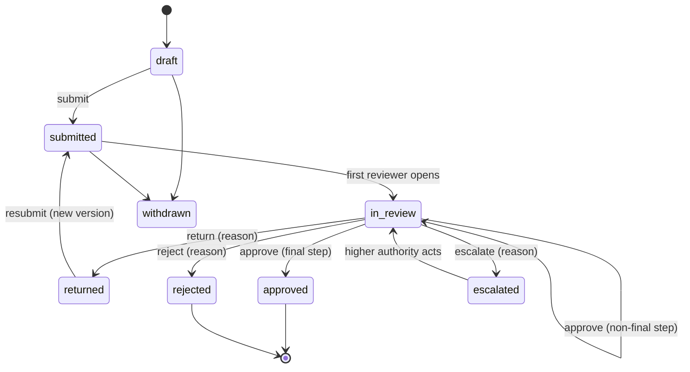
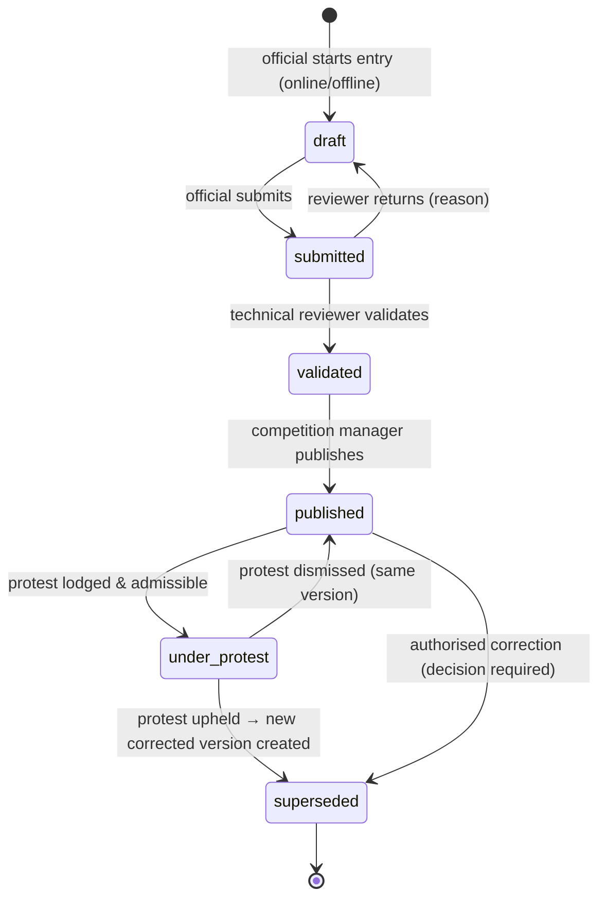

# 05 — Workflow & Approval Engine

The proposal's universal pattern: **submit → review → return with reasons / approve / escalate → correct**, with version history and evidence. Build one generic engine (`workflow` module) and configure every process on it. Do **not** pull in a heavyweight BPMN engine for the pilot.

## 1. Engine concepts

```ts
// packages/contracts/src/workflow.ts
export const WorkflowDefinition = z.object({
  code: z.string(),                    // 'plan_approval'
  version: z.number().int(),
  subjectType: z.string(),             // 'plans_grants.plan'
  steps: z.array(z.object({
    key: z.string(),                   // 'bureau_review'
    label: I18nText,
    actorPermission: z.string(),       // 'plans.plan.review'
    scopeFrom: z.enum(['subject_org', 'subject_parent_org', 'bureau', 'subject_sport_federation', 'subject_territory']),
    actions: z.array(z.enum(['approve', 'return', 'reject', 'escalate', 'delegate', 'comment'])),
    requiresReasonFor: z.array(z.string()).default(['return', 'reject', 'escalate']),
    requiredEvidence: z.array(z.string()).default([]),
    slaHours: z.number().optional(),
    next: z.record(z.string(), z.string()), // action -> next step key | 'END_APPROVED' | 'END_REJECTED' | 'RETURNED'
    guards: z.array(z.string()).default([]),  // named guard functions e.g. 'funding_available'
  })),
  segregation: z.array(z.tuple([z.string(), z.string()])), // steps that must have different actors
});
```

- **Submission** holds state + `current_step`. Each submit creates a new immutable `submission_version` (payload + attachments).
- **Return** moves state to `returned` and back to the submitter with a mandatory reason; resubmission creates version n+1; reviewer sees a diff.
- **Guards**: pluggable functions registered by modules (e.g. `plans_grants` registers `funding_available`; `competitions` registers `entries_window_open`).
- **SLA**: overdue steps create `action_item`s and appear in the command centre queue.
- **Escalation**: to the next authority defined in the step; logged.
- **Delegation**: temporary acting assignment (`iam.delegation`) with expiry; shown in audit as "on behalf of".
- **On approve END**: engine emits `workflow.approved {code, subjectType, subjectId, versionId}`; the owning module applies the effect (e.g. create affiliation). The engine never writes to other modules' tables.

## 2. Submission state machine



## 3. Configured workflows (pilot set)

| Code | Subject | Steps (pilot defaults — confirm in OD-03) |
|---|---|---|
| `org_recognition` | Club/academy onboarding | club.admin submits → fed.registrar review (duplicates, evidence) → fed.secretariat approve |
| `person_registration` | New person + affiliation | club.admin / self submits → fed.registrar verify identity & duplicates → approve (creates/updates person, affiliation) |
| `affiliation_change` | Transfer/new club in a sport | club.admin (receiving) submits → releasing club acknowledge (if rule set requires) → fed.registrar approve |
| `qualification_verification` | Coach/official qualification claim | person/club submits → fed technical dept verifies with issuer → approve/reject |
| `plan_approval` | Federation annual plan | fed.secretariat submits → bureau.reviewer (alignment, scheduling) → bureau.finance (guard `funding_available`) → bureau.approver decides |
| `delivery_report` | Activity delivery evidence | fed/territory submits → bureau.reviewer verifies evidence → status `verified` |
| `acquittal` | Grant acquittal | fed.finance submits → bureau.finance reconciles with finance reference |
| `competition_approval` | New competition | fed.competition_manager submits → fed.secretariat approves → (if games) bureau sign-off |
| `team_entry` / `individual_entry` | Entries | club.admin submits → eligibility engine runs → fed.registrar/competition_manager reviews exceptions → accept |
| `official_appointment` | Appointments | competition_manager proposes → official confirms/declines (conflict declaration) |
| `result_validation` | Result version | official submits → fed.technical_reviewer validates → competition_manager publishes |
| `protest` | Protest | org lodges (deadline guard) → admissibility → disciplinary/technical committee decision |
| `booking` | Facility booking | requester submits → facility.operator approves (conflict guard) → use verified after event |
| `work_order` | Maintenance | inspector raises defect → operator assigns → closure with evidence → inspector confirms |
| `referral` | Talent referral | development officer refers → receiving org accepts/declines → outcome recorded |
| `selection` | Regional team selection | development/technical officer proposes with criteria & reasons → federation authority approves |

## 4. Result lifecycle (competitions)



- A correction **always** creates `result_version(seq+1, previous_id=…)` and a linked `decision`. Old version → `superseded`. Standings/records recompute from the new published version; old standing snapshots retained.
- Public portal shows "Provisional", "Official", "Under protest", "Corrected on <date>" badges.

## 5. Eligibility engine

```ts
interface EligibilityRule {
  code: string;                       // 'age_category', 'active_affiliation', 'not_suspended', 'roster_limit', 'qualification_required'
  appliesTo: 'entry' | 'entry_member' | 'appointment';
  evaluate(ctx: EligibilityContext): Promise<{ outcome: 'pass' | 'fail' | 'exception'; details: Record<string, unknown> }>;
}
```

- Core rules (in `competitions`): active dated affiliation in **this sport** on event date; category age/gender match; not under sanction; clearance status where rule set requires; duplicates unresolved → `exception`.
- Sport rules come from the plugin (`plugin.eligibilityRules(ruleSet)`).
- Outcomes stored per member. `fail`/`exception` → reviewer must decide; override needs reason + permission `competitions.eligibility.override`.

## 6. Action queue (common across modules)

Sources that create `action_item`s automatically:
overdue obligation · workflow step past SLA · identity evidence incomplete · duplicate candidate open · qualification expiring in ≤ 60 days · eligibility exception · result submitted but not validated after N hours · protest deadline approaching · maintenance defect open · booking used without verification · financial exception (acquittal mismatch) · import rows held.

Closure requires the configured evidence (document, linked record or decision), not just a status click.

## 7. Notifications

Event → template (i18n) → channels (in-app always; email; SMS for time-critical: appointments, result publication to clubs, protest deadlines). User preferences respected except for mandatory notices. Digest option for reviewers.
